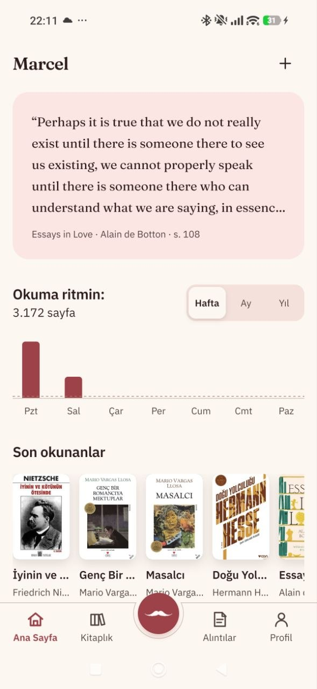
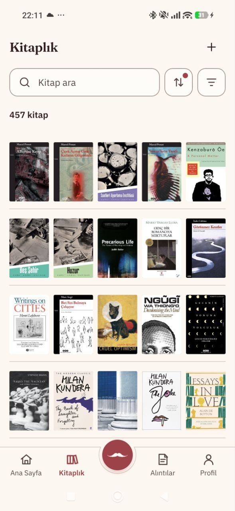
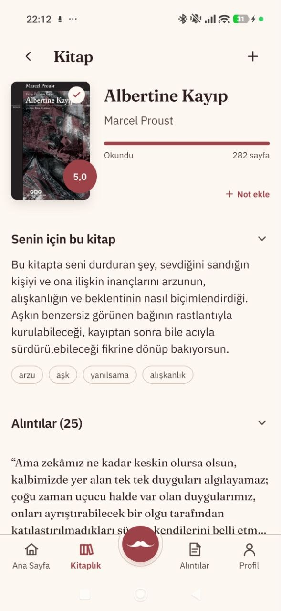
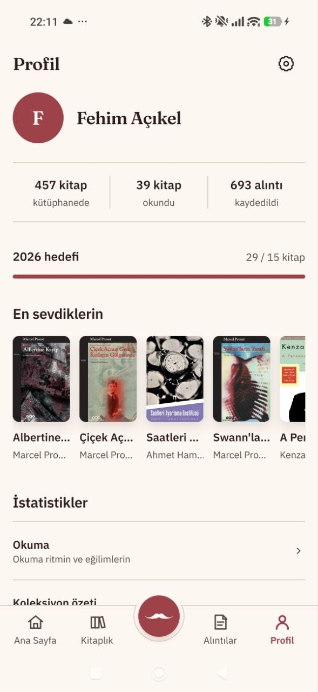
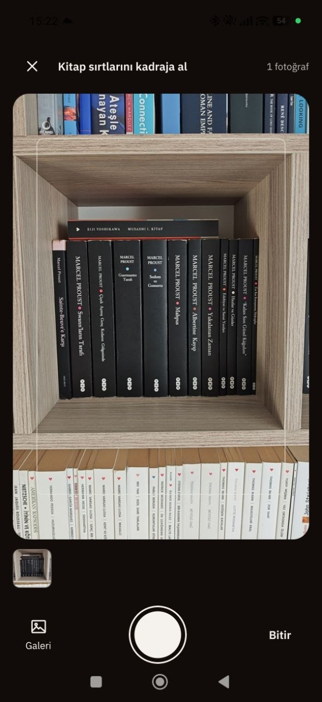
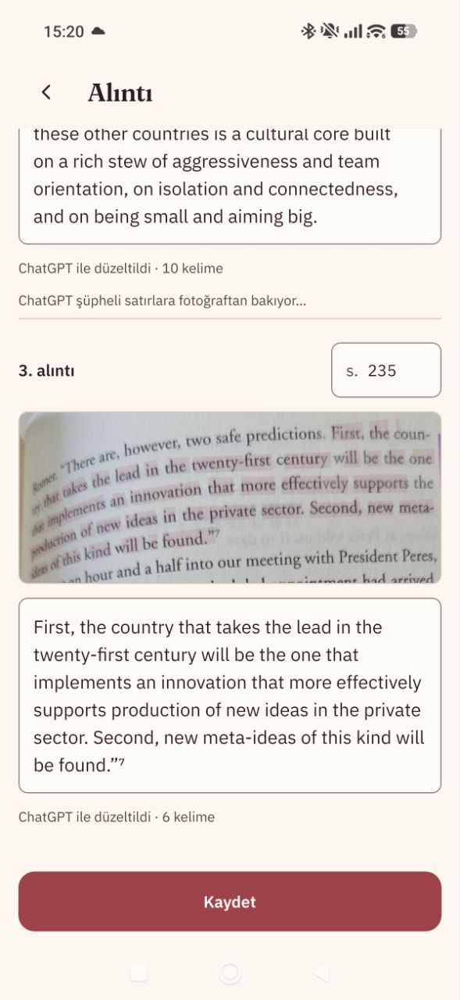
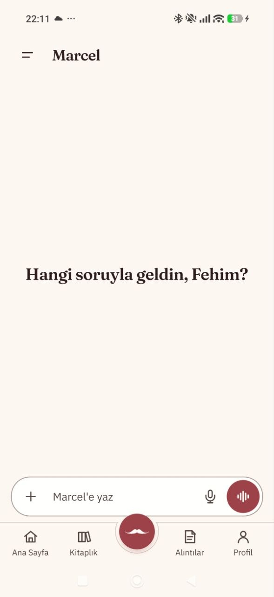
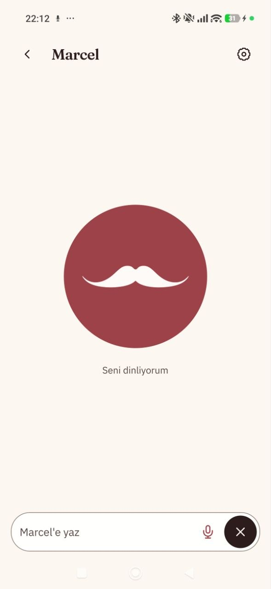

  

  <b>A personal library app with an AI reading companion that knows your books, remembers what you think and argues back.</b> 
  Android · October 2026 - present · Personal project

> The source code is private. This page describes the product; a live walkthrough is available on request.

Marcel keeps a physical book collection, reading history and favourite passages in one place, then lets you think with them through a companion that remembers.

## The library

  
  
  
  

- **The right book, not just a title.** Each copy keeps its own cover, publisher, page count, shelf location and the original publication year of the work, with sources. Missing information stays empty instead of being guessed.
- **"This book for you."** Every book carries a short note on what it means to its reader, with themes drawn from their passages, plus a summary with inline sources.
- **Reading without busywork.** Progress is tracked by page; a book counts as read once it is rated or finished, with no status buttons to manage. A yearly goal, reading rhythm and favourites follow from that.
- **Works offline.** Browsing, search, filters, reading and passages work without a connection and sync when the phone is back online.

## From the camera

  
  
  
  

- **Add books from a shelf photo.** Photograph a shelf or a stack; Marcel recognises each spine, checks it against the library so nothing is added twice, and researches the cover and details in the background.
- **Passages from the page.** Photograph one or several pages and mark the lines to keep. The text is recognised and split into paragraphs; doubtful lines are re-read by ChatGPT from the photo itself, fixing recognition errors without rewriting the author's words.
- **Linked to the exact page.** Each passage is saved with its book and page number, gets themes automatically, and is searchable alongside the rest.

## Marcel, the companion

  
  
  

- **A consistent character.** Talks like a friend about everyday things and at seminar depth about a book or an idea, adjusting tone and length to the question rather than to commands.
- **Honest, not agreeable.** Pushes back with reasons, and changes its view when given a better argument.
- **Finds the right passage.** Searches the user's books and passages by meaning as well as by keyword before answering, and uses the web when the library is not enough.
- **Faithful to the source.** The model points to a passage; the app shows the stored text with its book and page. Quotes are never written by the AI.
- **Visible memory.** Keeps a short list of notes about the user and its own views. Each new note appears as "Noted · Undo" and can be corrected or forgotten in conversation.
- **Text or real-time voice.** The same conversation, memory and tools, typed or spoken.
- **Acts in the app.** Opens a book or passage, adds a quote or logs reading progress when asked, each with Undo.

## Product principles

1. **Zero input.** No forms, prompts or notes required. Marcel learns from ratings, passages and conversation.
2. **Source fidelity.** Every quote and fact traces back to a record or a source; nothing is invented to fill a gap.
3. **Adapt, don't rebuild.** The intelligence comes from the model, which can be swapped as better ones arrive. Marcel runs on the user's own ChatGPT plan at no extra cost.
4. **Quiet AI.** No confidence scores, provider names or job queues in the interface; the app asks a question only when the answer changes a decision.
5. **The data belongs to the user.** Library, conversations and memory are synced to the user's own server, so a new phone restores everything.

## Built with

Expo (React Native) · TypeScript · on-device SQLite with offline sync · Cloudflare Workers, D1, Vectorize and Workers AI · OpenAI models through Sign in with ChatGPT, including real-time voice

Designed and built with AI coding agents (Claude Code and Codex), in phases that each closed with an on-device review.
